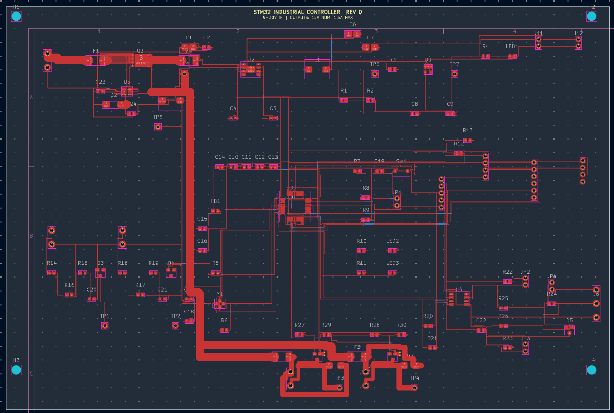
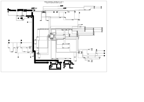
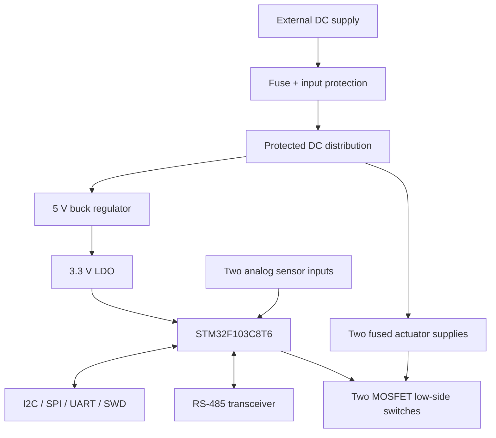

# STM32 Industrial Sensor, DAQ & Actuator Controller

**Status: CAD-stage portfolio design (Revision D). Not fabricated, physically tested, or approved for industrial deployment.**

This repository contains an **AI-assisted** electronic design project built around an STM32F103C8T6 microcontroller, with a four-layer KiCad PCB, mixed-signal sensing, low-voltage power conversion, wired communications, and two switched DC actuator channels. It showcases design-file organization, schematic/PCB review, bill-of-materials management, and documented limitations.

## PCB Design Gallery

### PCB Layout

### 3D PCB View

### Front Copper Routing

### Electrical Schematic
[View Schematic PDF](KiCad/STM32_Industrial_Controller.pdf)

## At a glance

| Aspect | Revision D design target / supplied evidence |
| --- | --- |
| PCB | 4 layers, 218 × 146 mm, 1.6 mm FR-4 (per fabrication notes) |
| Controller | STM32F103C8T6, 3.3 V logic |
| Input | 9–30 V DC for logic; actuator supply specified separately as 9–18 V, nominal 12 V |
| Power rails | 5 V buck regulator, 3.3 V LDO |
| Analog sensing | Two nominal 0–10 V inputs with scaling/filtering to MCU ADC range |
| Interfaces | I²C, SPI, UART, SWD, half-duplex RS-485 |
| Actuators | Two nominal 1.5 A low-side switched channels (design target, not measured) |
| Schematic ERC | **0 errors / 0 warnings** in supplied Revision D report; four ERC check categories ignored |
| PCB DRC | **0 reported violations; 0 unconnected pads; 0 footprint errors**, none ignored in supplied report |
| Firmware | Not included in this Revision D archive; no firmware build or tests claimed |
| Physical verification | **Not performed** |

## System overview

The block diagram summarizes intended functions; it does not replace the authoritative schematic or prove electrical performance.

## Repository layout

- [`KiCad/`](KiCad/) — editable KiCad 10 schematic and four-layer PCB, project settings and local footprints.
- [`Manufacturing/`](Manufacturing/) — existing design-stage Gerbers, drills, BOM, placement outputs, ERC/DRC reports, and fabrication notes. **Not approved for production or ordering.**
- [`Documentation/DESIGN_SUMMARY.md`](Documentation/DESIGN_SUMMARY.md) — architecture and design assumptions.
- [`Documentation/VERIFICATION_STATUS.md`](Documentation/VERIFICATION_STATUS.md) — what has and has not been validated.
- [`Documentation/OPEN_DESIGN_ITEMS.md`](Documentation/OPEN_DESIGN_ITEMS.md) — unresolved concerns and disclosure statements.
- [`Documentation/PORTFOLIO_PRESENTATION.md`](Documentation/PORTFOLIO_PRESENTATION.md) — GitHub and resume wording with attribution guidance.
- [`Documentation/FINISHING_CHECKLIST.md`](Documentation/FINISHING_CHECKLIST.md) — minimal remaining steps for a CAD-only portfolio.
- [`Documentation/Original_Revision_D_README.md`](Documentation/Original_Revision_D_README.md) — README supplied with original Revision D archive, preserved unchanged.

## Opening the project

1. Open `KiCad/STM32_Industrial_Controller.kicad_pro` in KiCad 10 on macOS.
2. Open the `.kicad_sch` schematic and `.kicad_pcb` board.
3. Run **Inspect → Electrical Rules Checker** in Schematic Editor.
4. Run **Inspect → Design Rules Checker** in PCB Editor, enabling zone refill and schematic-parity checking.
5. Capture schematic, copper-layer, and KiCad 3D Viewer screenshots for the portfolio; see the finishing checklist.

## Engineering status and limitations

The **provided** ERC and DRC reports show clean CAD rule checks. Those checks do not establish functional electrical correctness, actual thermal performance, component suitability, assembly fit, or field reliability. An independent KiCad rerun was not performed during preparation of these portfolio documents.

**Known unresolved review item:** the design directly drives `IRLML0060` MOSFET gates from approximately 3.3 V MCU logic. Their guaranteed on-resistance is not specified at that exact gate voltage in the previously reviewed datasheet. The 1.5 A actuator performance at 3.3 V gate drive is therefore **not claimed as verified**. A separate gate-driver integration was proposed but was **not incorporated into this Revision D baseline**. Additional footprint/mechanical and continuous-current/thermal reviews remain open; see [`OPEN_DESIGN_ITEMS.md`](Documentation/OPEN_DESIGN_ITEMS.md).

**This design is not a safety controller, not a certified industrial product, and not a physical prototype.**

## Attribution and interview use

The board files were created and refined with AI assistance and iterative human review. Describe contributions accurately, explain the underlying circuits, and do not suggest independent end-to-end hardware engineering work, measured performance, or firmware completion that was not actually performed. See [`PORTFOLIO_PRESENTATION.md`](Documentation/PORTFOLIO_PRESENTATION.md).
